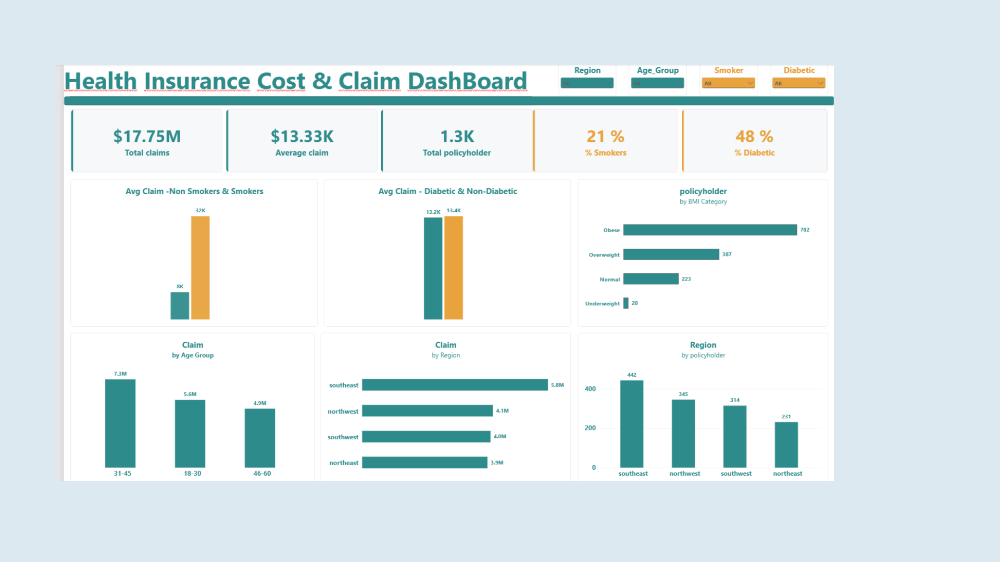
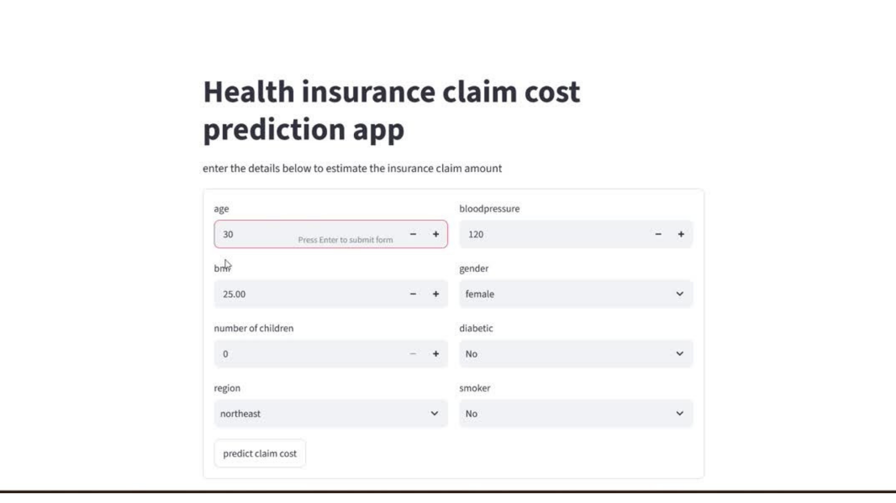
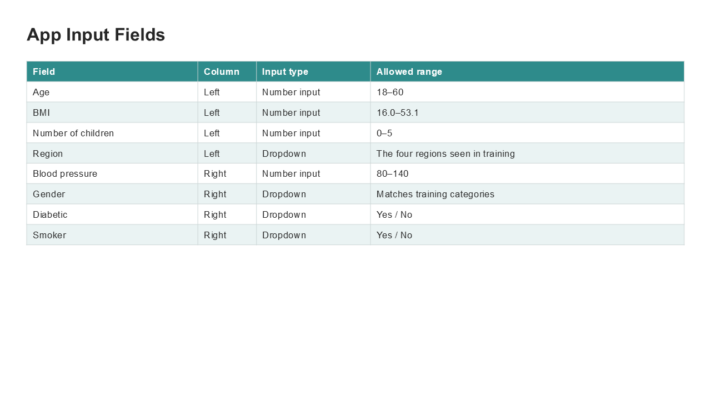
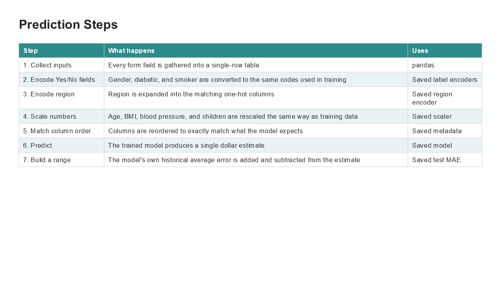

# Insurance Claim Intelligence

End-to-end analysis and machine learning prediction of health insurance claim costs, from raw data to a Power BI dashboard and a Streamlit app.




## Key results

| Policyholders | Total claims | Average claim | Best test R² | Test MAE |
|:---:|:---:|:---:|:---:|:---:|
| 1,332 | $17.75M | $13.33K | 0.81 (XGBoost) | $3,906 |

- **Smoking is the strongest driver found:** smokers average $30.7K to $33.0K per claim by gender, non-smokers $8.2K to $8.8K.
- **Blood pressure has the strongest numeric correlation** with claim amount (0.53), ahead of BMI (0.20). Age shows almost none (-0.03).
- **Northeast has the highest average claim** ($16.9K) and the highest share of smokers (about 29%). Southeast has the largest total ($5.8M).

## Contents

- [Business problem](#business-problem)
- [Data](#data)
- [Approach](#approach)
- [Model performance](#model-performance)
- [Prediction app](#prediction-app)
- [Repository structure](#repository-structure)
- [Limitations and next steps](#limitations-and-next-steps)
- [Author](#author)

## Business problem

> This is a practice project. Valuelink is a fictional company name used for the business scenario.

Claims data was reviewed manually, with no central reporting. Teams pulled separate cuts and reached inconsistent figures. The goal was a governed dataset, a self-service dashboard, a predictive model and a tool for non-technical users.

[Business request](reports/business-request.pdf) · [Executive summary](reports/executive-summary.pdf)

## Data

The source file has 1,340 records and 10 columns.

| Field | Description |
|---|---|
| `Id` | Record identifier (not used by the model) |
| `age` | Age in years |
| `gender` | Male or female |
| `bmi` | Body mass index |
| `bloodpressure` | Blood pressure reading |
| `diabetic` | Yes or no |
| `children` | Number of children |
| `smoker` | Yes or no |
| `region` | Northeast, Northwest, Southeast or Southwest |
| `claim` | Claim amount in dollars (target) |

**Cleaning:** no duplicates were found. Eight rows with a missing `age` or `region` were removed, leaving 1,332.

[Cleaning code](reports/data-cleaning.pdf) · [Data dictionary](reports/data-dictionary.pdf)

## Approach

1. Remove rows with missing values and check for duplicates.
2. Explore distributions, correlations and cost drivers.
3. Build the Power BI dashboard.
4. Label-encode `gender`, `diabetic` and `smoker`.
5. Split the data 80/20 (1,065 training and 267 test rows) and scale numeric fields using the training data.
6. Compare five models, tuning Random Forest, SVR and XGBoost with 3-fold cross-validation.
7. Save the best model for use in an app.

The model uses seven inputs: age, gender, BMI, blood pressure, diabetic status, children and smoker status. `region` is analyzed but not used by this model.

[Analysis notebook (HTML export, download to view)](notebooks/analysis.html)

To run the code you need `data.csv`, which is not included here. Install the libraries with `pip install -r requirements.txt`.

## Model performance

Test set results from the analysis notebook:

| Model | R² | MAE | RMSE |
|---|---:|---:|---:|
| **XGBoost (selected)** | **0.81** | **$3,906** | **$5,433** |
| Random Forest | 0.79 | $3,964 | $5,584 |
| Polynomial Regression (degree 3) | 0.76 | $4,355 | $6,045 |
| Linear Regression | 0.69 | $5,147 | $6,814 |
| Support Vector Regression | 0.51 | $5,715 | $8,595 |

The test set was also used to choose the polynomial degree and the winning model, so these scores are likely somewhat optimistic. The split has no fixed random seed, so a new run will give different numbers.

## Prediction app

<p align="center">
  
</p>

The screenshots and video show an app version that also asks for `region`. The code for that version is not published here.

[Download the demo video](demo/app-demo.mp4)

<details>
<summary>Input fields and prediction steps</summary>





</details>

## Repository structure

```text
├── demo/       App walkthrough video
├── images/     Dashboard and app screenshots
├── notebooks/  Python analysis (HTML export)
├── reports/    Business request, summary and technical PDFs
├── README.md
└── requirements.txt
```

## Limitations and next steps

- Some PDF reports and the model dashboard quote a different modeling run (test R² 0.83, with region and a validation split). Use the notebook figures above until they are aligned.
- Add a validation set and a fixed random seed.
- Fix the regional smoker-rate chart in the notebook: it compares against `"yes"`, but the data uses `"Yes"`, so it shows 0%.
- Publish the app code, saved model files, dataset and Power BI file.

## Author

**Emeka Victor Agbo** · [GitHub](https://github.com/bryan405)
